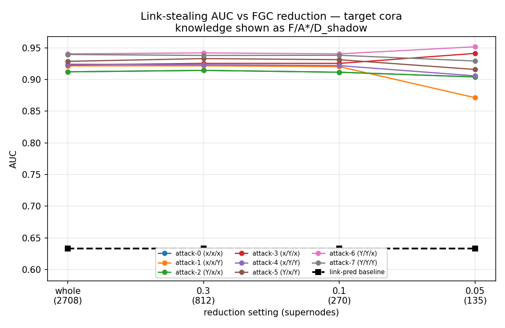
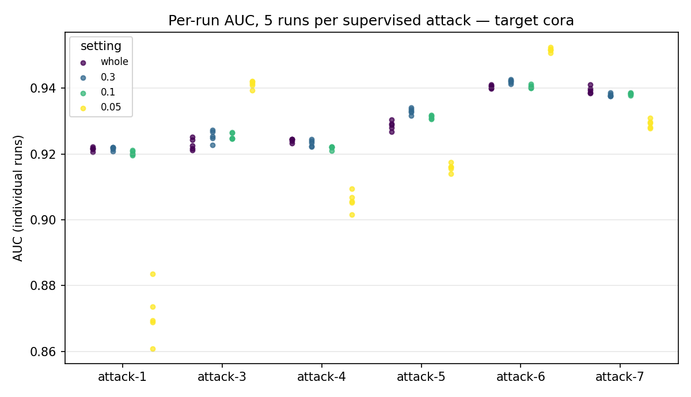
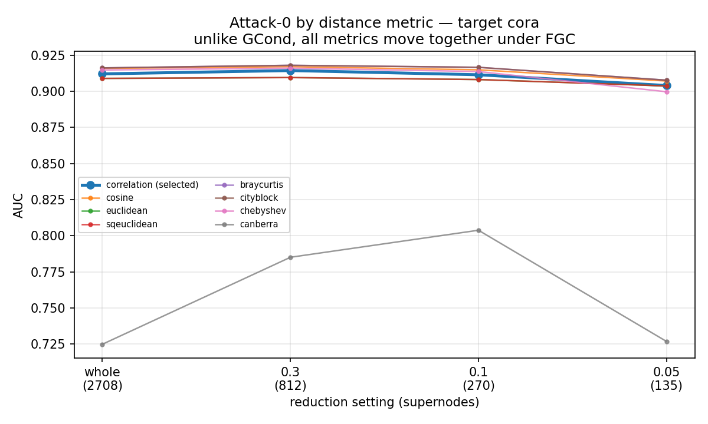
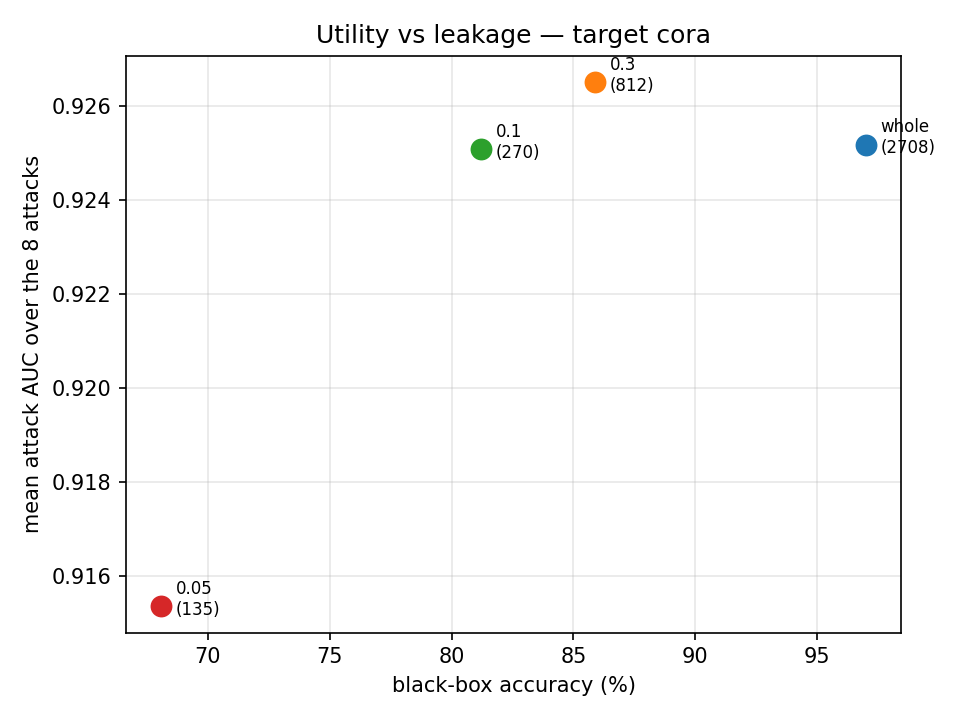
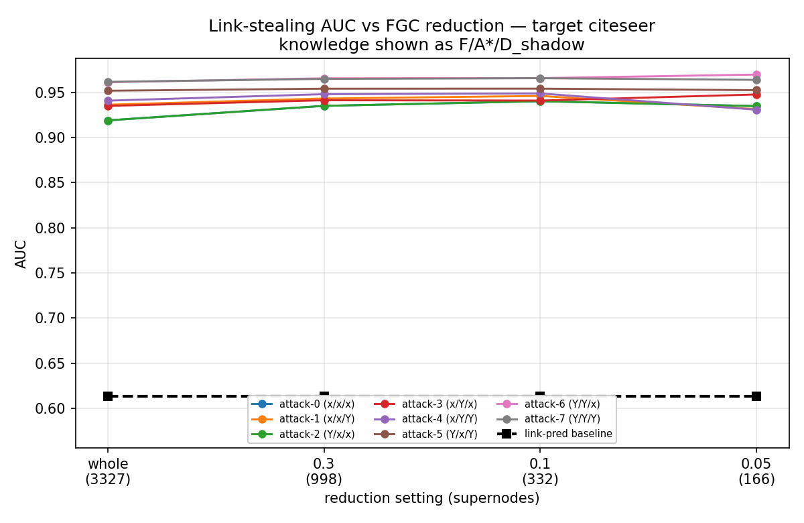
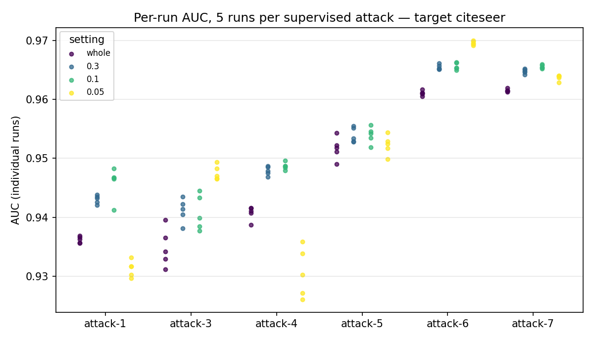
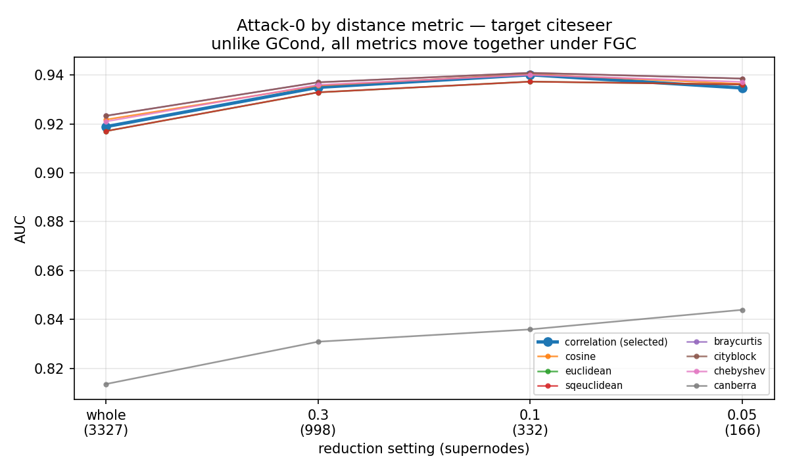
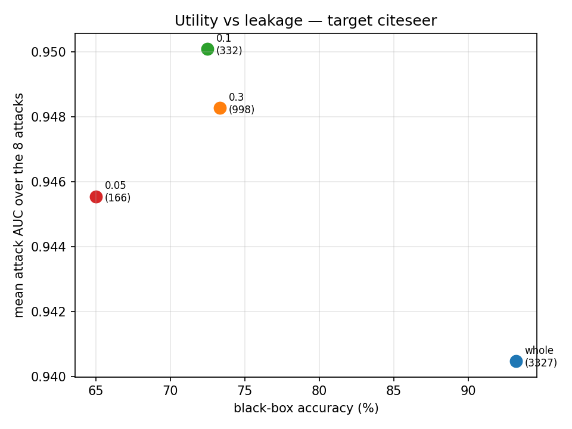

# FGC leakage benchmark — results

Do the 8 link-stealing attacks of He et al. (USENIX Security 2021) get weaker when the target GNN is trained on an FGC-coarsened graph (Kumar et al., ICML 2023)?

**No.** Reducing Cora's training graph from 2708 nodes to 135 — a 20x reduction costing 29 accuracy points — moves mean attack AUC by -0.0098. On Citeseer the mean moves *upward*. Every attack stays far above the link-prediction baseline at every reduction ratio.

Attacks query **Mode A**: the trained GNN run over the original adjacency, which is FGC's own evaluation protocol.

Knowledge triples are the paper's Table 3 (F / A* / D_shadow). The third slot is the shadow dataset; the reference model `g` is derived from F and exists only in the F=Y attacks.

## Target cora, shadow citeseer

| attack | F/A*/D' | whole | 0.3 | 0.1 | 0.05 | delta |
|---|---|---|---|---|---|---|
| attack-0 | x/x/x | 0.9121 | 0.9144 | 0.9115 | 0.9040 | -0.0081 |
| attack-1 | x/x/Y | 0.9215 | 0.9216 | 0.9203 | 0.8712 | -0.0503 |
| attack-2 | Y/x/x | 0.9121 | 0.9144 | 0.9115 | 0.9040 | -0.0081 |
| attack-3 | x/Y/x | 0.9230 | 0.9254 | 0.9254 | 0.9412 | +0.0182 |
| attack-4 | x/Y/Y | 0.9241 | 0.9233 | 0.9219 | 0.9057 | -0.0184 |
| attack-5 | Y/x/Y | 0.9286 | 0.9330 | 0.9313 | 0.9158 | -0.0128 |
| attack-6 | Y/Y/x | 0.9405 | 0.9420 | 0.9405 | 0.9517 | +0.0112 |
| attack-7 | Y/Y/Y | 0.9395 | 0.9379 | 0.9383 | 0.9292 | -0.0103 |
| link-pred | – | 0.6329 | 0.6329 | 0.6329 | 0.6329 | +0.0000 |
| **mean of 8** | | **0.9252** | **0.9265** | **0.9251** | **0.9154** | **-0.0098** |

Black-box utility for the same settings:

| setting | supernodes (nominal / used) | accuracy | paper | delta |
|---|---|---|---|---|
| whole | 2708 / 2708 | 97.01 ± 0.18 | 89.50 | +7.51 |
| 0.3 | 812 / 594 | 85.89 ± 0.27 | 85.79 | +0.10 |
| 0.1 | 270 / 250 | 81.21 ± 0.89 | 81.46 | -0.25 |
| 0.05 | 135 / 131 | 68.08 ± 2.21 | 80.01 | -11.93 |

## Target citeseer, shadow cora

| attack | F/A*/D' | whole | 0.3 | 0.1 | 0.05 | delta |
|---|---|---|---|---|---|---|
| attack-0 | x/x/x | 0.9188 | 0.9349 | 0.9401 | 0.9347 | +0.0158 |
| attack-1 | x/x/Y | 0.9362 | 0.9430 | 0.9459 | 0.9313 | -0.0049 |
| attack-2 | Y/x/x | 0.9188 | 0.9349 | 0.9401 | 0.9347 | +0.0158 |
| attack-3 | x/Y/x | 0.9349 | 0.9411 | 0.9408 | 0.9475 | +0.0127 |
| attack-4 | x/Y/Y | 0.9407 | 0.9479 | 0.9487 | 0.9306 | -0.0101 |
| attack-5 | Y/x/Y | 0.9517 | 0.9539 | 0.9540 | 0.9523 | +0.0006 |
| attack-6 | Y/Y/x | 0.9611 | 0.9655 | 0.9656 | 0.9696 | +0.0085 |
| attack-7 | Y/Y/Y | 0.9615 | 0.9648 | 0.9656 | 0.9637 | +0.0022 |
| link-pred | – | 0.6130 | 0.6130 | 0.6130 | 0.6130 | +0.0000 |
| **mean of 8** | | **0.9405** | **0.9483** | **0.9501** | **0.9455** | **+0.0051** |

Black-box utility for the same settings:

| setting | supernodes (nominal / used) | accuracy | paper | delta |
|---|---|---|---|---|
| whole | 3327 / 3327 | 93.21 ± 0.18 | 78.08 | +15.13 |
| 0.3 | 998 / 368 | 73.33 ± 0.40 | 74.64 | -1.31 |
| 0.1 | 332 / 321 | 72.50 ± 0.40 | 73.36 | -0.86 |
| 0.05 | 166 / 163 | 65.01 ± 0.76 | 71.02 | -6.01 |

## Compared with the GCond benchmark

Both benchmarks attack identical node pairs with identical 50/50 splits (shared pair seed 1) using the same attack code, so mean AUCs are directly comparable. Reduction axes differ: GCond synthesises 35-140 nodes, FGC merges into 135-998 supernodes.

| benchmark | target | weakest reduction | strongest reduction | change |
|---|---|---|---|---|
| FGC | cora | 0.9252 (whole) | 0.9154 (0.05) | -0.0098 |
| GCond | cora | 0.9390 (whole) | 0.9502 (1.0) | +0.0112 |
| FGC | citeseer | 0.9405 (whole) | 0.9455 (0.05) | +0.0051 |
| GCond | citeseer | 0.9704 (whole) | 0.9601 (1.0) | -0.0103 |

Both are noise-level and the sign is inconsistent across datasets in both, which is what you expect if the amount of reduction is simply not the operative variable. The mechanism is the same in both: inference runs over the original adjacency, so the edge signal the attacks exploit is re-injected at query time no matter how small the training graph was.

## Attack setup

| element | value |
|---|---|
| attack model | MLP, 3 hidden layers x 32, ReLU, dropout, softmax |
| optimiser | Adam, lr 0.001, cross-entropy, batch 128, 50 epochs |
| repetitions | 5 (attacks 0 and 2 are unsupervised, 1 run) |
| adversary's attributes | **original, pre-coarsening** |
| adversary's labels | random 10%, seed 123 |
| reference model g | graph-free mirror of the target: hidden 64, 60 epochs, lr 0.01, wd 0.0001 |
| shadow target | the other dataset at the same reduction setting |
| ground truth | original edges: 5278 Cora, 4552 Citeseer |
| pair sampling | all edges + equal non-edges, random 50/50 split, seed 1 |

## Figures

## Reproduction notes

Two settings do not reproduce the paper's accuracy and are reported as our own measurements: Cora r=0.05 (68.08 against 80.01) and Citeseer r=0.05 (65.01 against 71.02). Citeseer r=0.3 matches on accuracy but its partition is degenerate -- 1622 of 3327 nodes fall into one supernode, so its effective reduction is nearer 368 groups than 998. `beta` has no published value and is selected per setting from the authors' own grid by closeness to Table 4, so Mode A agreement at r=0.3 and r=0.1 is not independent evidence. Per-box numbers are in `step02_validation.json`.
