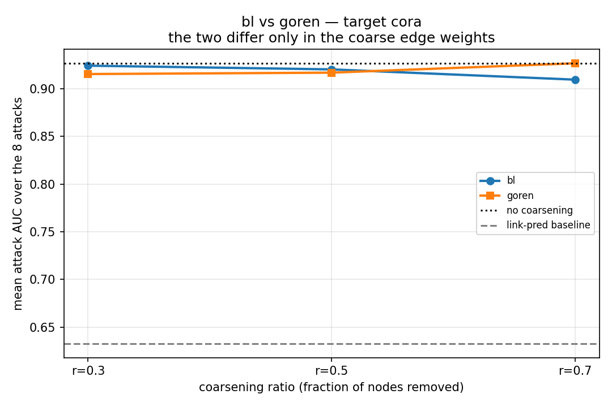
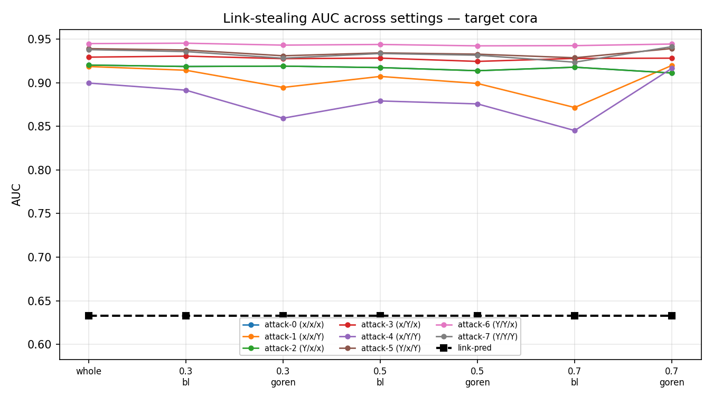
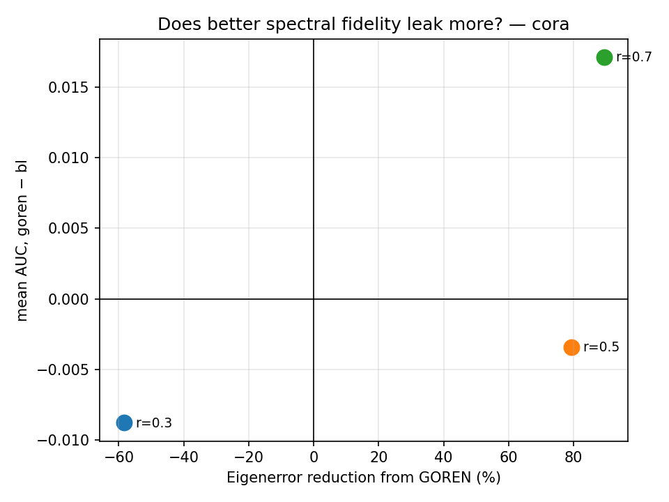
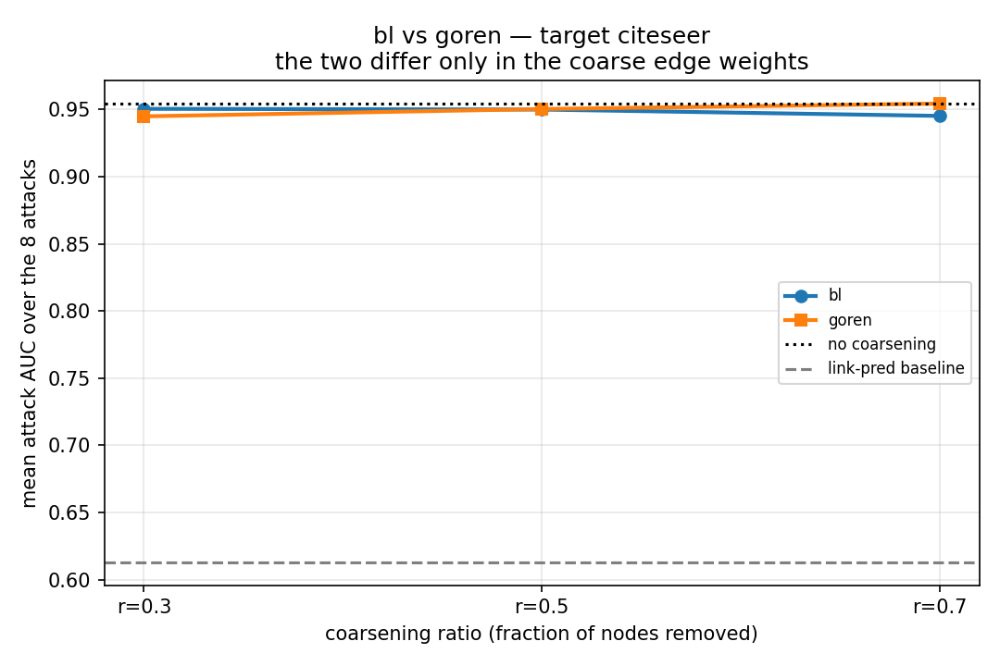
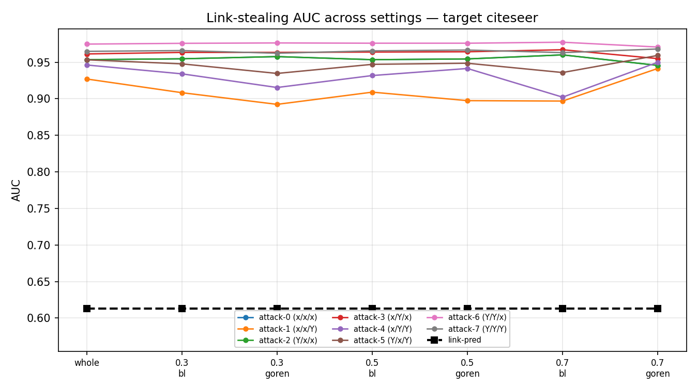
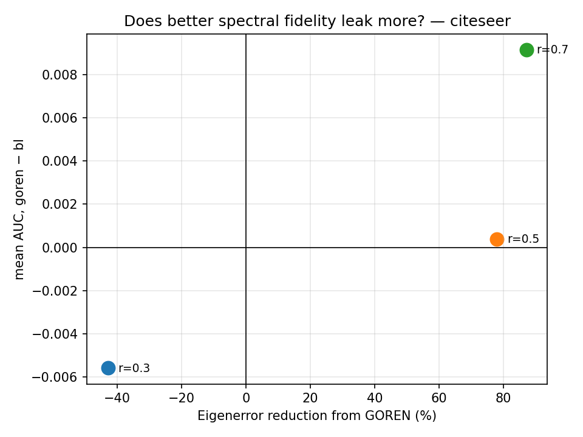

# GOREN leakage benchmark — results

Do the 8 link-stealing attacks of He et al. (USENIX Security 2021) get weaker when the target GNN is trained on a coarse graph whose edge weights GOREN (Cai, Wang & Wang, ICLR 2021) has relearned?

GOREN does not build a partition. It takes a coarse graph produced by Loukas's `variation_neighborhoods` and relearns its edge weights against a spectral objective. So this benchmark has a paired structure that the other three do not:

| variant | coarse edge weights |
|---|---|
| `bl` | `S^T A S`, the count of original edges between each pair of supernodes |
| `goren` | the same edges, weights predicted by GOREN's GIN |

Same k, same partition, same coarse features, same coarse labels, same split, same classifier. Only the weight vector differs, so any AUC gap is attributable to GOREN alone.

The paper never runs node classification -- its evaluation is entirely spectral -- so there is no published accuracy for any dataset, and it uses neither Cora nor Citeseer. Every accuracy here is our own measurement. The one paper-grounded check is the Eigenerror reduction, in `step02a_goren_weights.json`.

## Target cora, shadow citeseer

| attack | F/A*/D' | whole | 0.3_bl | 0.3_goren | 0.5_bl | 0.5_goren | 0.7_bl | 0.7_goren |
|---|---|---|---|---|---|---|---|---|
| attack-0 | x/x/x | 0.9202 | 0.9186 | 0.9190 | 0.9173 | 0.9137 | 0.9177 | 0.9111 |
| attack-1 | x/x/Y | 0.9185 | 0.9143 | 0.8946 | 0.9072 | 0.8991 | 0.8716 | 0.9198 |
| attack-2 | Y/x/x | 0.9202 | 0.9186 | 0.9190 | 0.9173 | 0.9137 | 0.9177 | 0.9111 |
| attack-3 | x/Y/x | 0.9293 | 0.9304 | 0.9276 | 0.9282 | 0.9244 | 0.9279 | 0.9281 |
| attack-4 | x/Y/Y | 0.8996 | 0.8914 | 0.8593 | 0.8791 | 0.8757 | 0.8451 | 0.9165 |
| attack-5 | Y/x/Y | 0.9390 | 0.9375 | 0.9308 | 0.9342 | 0.9327 | 0.9286 | 0.9391 |
| attack-6 | Y/Y/x | 0.9448 | 0.9453 | 0.9431 | 0.9438 | 0.9422 | 0.9425 | 0.9443 |
| attack-7 | Y/Y/Y | 0.9379 | 0.9356 | 0.9281 | 0.9335 | 0.9315 | 0.9235 | 0.9413 |
| link-pred | – | 0.6329 | 0.6329 | 0.6329 | 0.6329 | 0.6329 | 0.6329 | 0.6329 |
| **mean of 8** | | **0.9262** | **0.9240** | **0.9152** | **0.9201** | **0.9166** | **0.9093** | **0.9264** |

## Target citeseer, shadow cora

| attack | F/A*/D' | whole | 0.3_bl | 0.3_goren | 0.5_bl | 0.5_goren | 0.7_bl | 0.7_goren |
|---|---|---|---|---|---|---|---|---|
| attack-0 | x/x/x | 0.9535 | 0.9547 | 0.9577 | 0.9535 | 0.9545 | 0.9600 | 0.9456 |
| attack-1 | x/x/Y | 0.9270 | 0.9083 | 0.8923 | 0.9090 | 0.8974 | 0.8968 | 0.9415 |
| attack-2 | Y/x/x | 0.9535 | 0.9547 | 0.9577 | 0.9535 | 0.9545 | 0.9600 | 0.9456 |
| attack-3 | x/Y/x | 0.9613 | 0.9634 | 0.9634 | 0.9639 | 0.9643 | 0.9671 | 0.9549 |
| attack-4 | x/Y/Y | 0.9462 | 0.9341 | 0.9154 | 0.9317 | 0.9414 | 0.9022 | 0.9500 |
| attack-5 | Y/x/Y | 0.9533 | 0.9477 | 0.9346 | 0.9471 | 0.9486 | 0.9359 | 0.9593 |
| attack-6 | Y/Y/x | 0.9748 | 0.9758 | 0.9764 | 0.9760 | 0.9760 | 0.9773 | 0.9707 |
| attack-7 | Y/Y/Y | 0.9648 | 0.9659 | 0.9623 | 0.9655 | 0.9666 | 0.9631 | 0.9681 |
| link-pred | – | 0.6130 | 0.6130 | 0.6130 | 0.6130 | 0.6130 | 0.6130 | 0.6130 |
| **mean of 8** | | **0.9543** | **0.9506** | **0.9450** | **0.9500** | **0.9504** | **0.9453** | **0.9545** |

## The paired comparison

| setting | Eigenerror reduction | box acc bl | box acc goren | mean AUC bl | mean AUC goren | AUC goren − bl |
|---|---|---|---|---|---|---|
| cora r=0.3 | -58.5% | 87.85 | 87.26 | 0.9240 | 0.9152 | -0.0088 |
| cora r=0.5 | +79.3% | 87.33 | 86.81 | 0.9201 | 0.9166 | -0.0034 |
| cora r=0.7 | +89.4% | 87.22 | 87.70 | 0.9093 | 0.9264 | +0.0171 |
| citeseer r=0.3 | -42.8% | 75.45 | 75.15 | 0.9506 | 0.9450 | -0.0056 |
| citeseer r=0.5 | +77.9% | 74.70 | 75.06 | 0.9500 | 0.9504 | +0.0004 |
| citeseer r=0.7 | +87.1% | 74.43 | 75.18 | 0.9453 | 0.9545 | +0.0092 |

## Attack setup

| element | value |
|---|---|
| attack model | MLP, 3 hidden layers x 32, ReLU, dropout, softmax |
| optimiser | Adam, lr 0.001, cross-entropy, batch 128, 50 epochs |
| repetitions | 5 (attacks 0 and 2 are unsupervised, 1 run) |
| adversary's attributes | original node attributes |
| adversary's labels | random 10%, seed 123 |
| reference model g | graph-free mirror of the target: hidden 64, 500 epochs, lr 0.003, wd 0.0005 |
| shadow target | the other dataset at the same setting |
| ground truth | original edges: 5278 Cora, 4552 Citeseer |
| pair sampling | all edges + equal non-edges, random 50/50 split |

## Black box

| element | value | source |
|---|---|---|
| coarsening | Loukas `variation_neighborhoods`, K=10 | graph_coarsening |
| ratio | fraction of nodes REMOVED | BinWidthFinder convention |
| GOREN weights | GIN, LDP node features, edge attrs init 1, final ReLU, Adam lr 0.001 | paper section 3 |
| GOREN loss | diagonal quadratic form on bottom-40 eigenvectors, Rayleigh-normalised by `C^T C`, projection `1/\|s\|` | loss_util |
| classifier | GCN, 3 GCNConv: d -> 64 -> 64 -> classes, edge weights threaded through | ours |
| optimiser | Adam, lr 0.003, decay 0.0005, 500 epochs | ours |
| split | random 60/20/20, best-validation weights | ours |
| inference | original graph, unit weights | ours |

## Figures

## Notes

GOREN's learned weights reach the black box only through the trained parameters, never at query time, because inference runs over the original graph with unit weights. That is a weaker channel than in the UGC benchmark, where the adjacency entered the serving path directly as input features, so a small `goren − bl` gap should be read as the channel being indirect rather than as spectral fidelity being irrelevant.

The two r=0.3 settings are the falsification control: there GOREN makes the coarse graph a *worse* spectral approximation (Eigenerror reduction −58.5% on Cora, −42.8% on Citeseer), so if leakage tracked fidelity the AUC gap should point the other way there than at r=0.5 and r=0.7.
