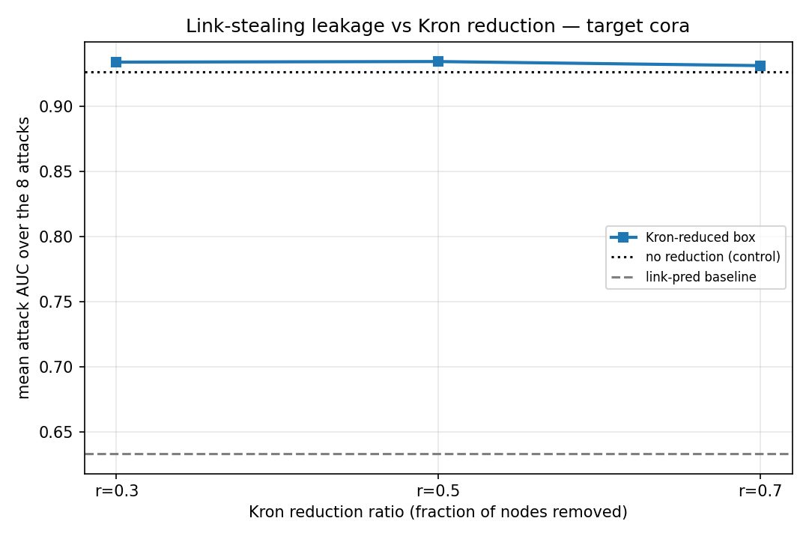
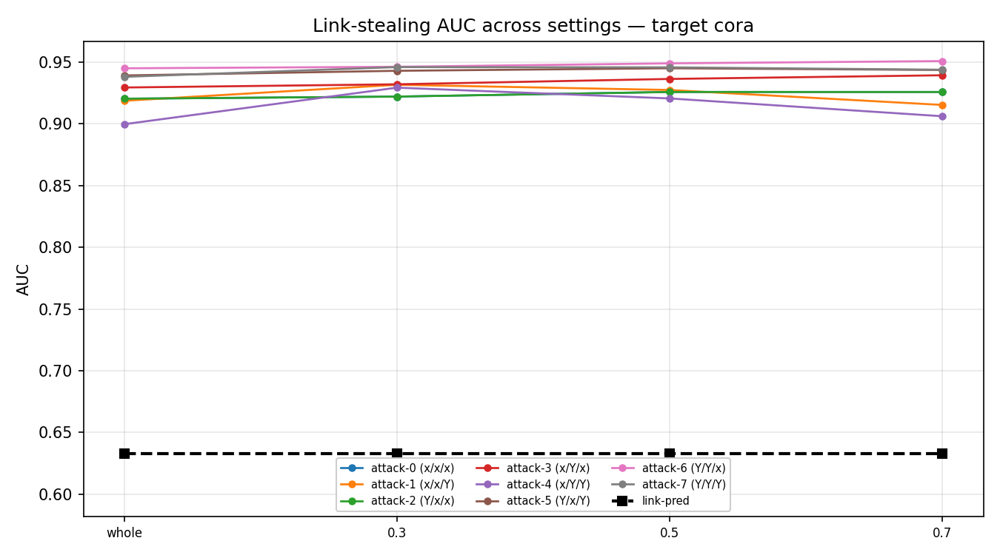
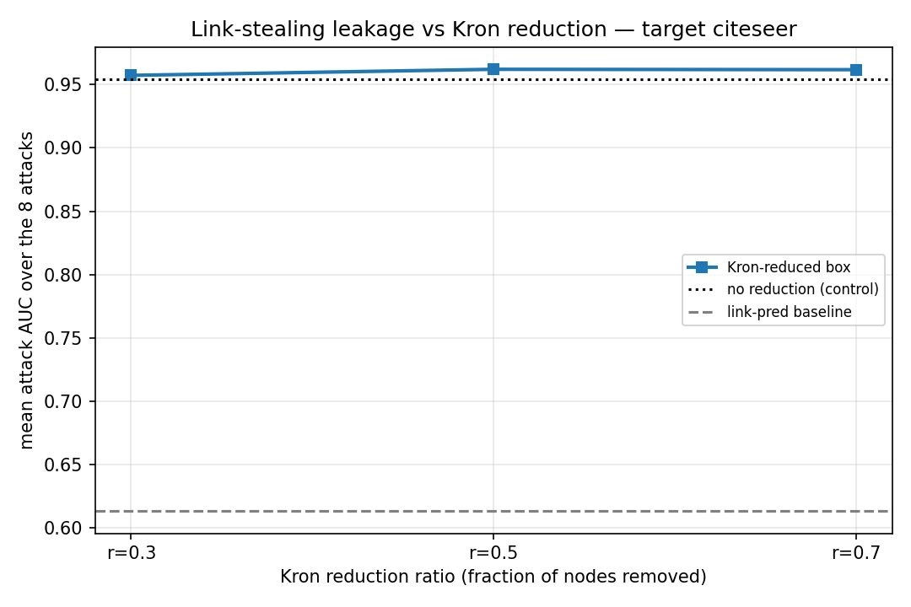
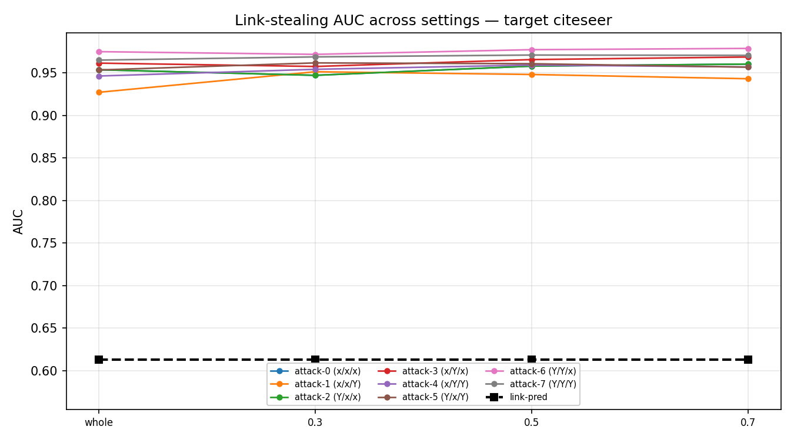

# KRON leakage benchmark — results

Do the 8 link-stealing attacks of He et al. (USENIX Security 2021) get weaker when the target GNN is trained on a Kron-reduced graph (Dorfler & Bullo, arXiv 1102.2950)?

Kron reduction eliminates a set of interior nodes by taking the Schur complement of the graph Laplacian with respect to them. The surviving boundary nodes are a subset of the ORIGINAL nodes and keep their own features and labels, so unlike the coarsening benchmarks nothing is merged into a synthetic supernode. Here the interior is the lowest-degree n*r nodes, chosen per connected component so every component keeps at least one boundary node.

Each reduced box is trained on the reduced graph and evaluated on the original graph, so the only difference from its own control is the training graph. The paper never runs node classification, so there is no published accuracy for any dataset and it uses neither Cora nor Citeseer. Every accuracy here is our own measurement; the one paper-grounded check is that the reduced matrix is a valid Laplacian (max|L_red @ 1| ~ 1e-14, step 01).

## Target cora, shadow citeseer

| attack | F/A*/D' | whole | 0.3 | 0.5 | 0.7 |
|---|---|---|---|---|---|
| attack-0 | x/x/x | 0.9202 | 0.9219 | 0.9257 | 0.9257 |
| attack-1 | x/x/Y | 0.9185 | 0.9315 | 0.9273 | 0.9152 |
| attack-2 | Y/x/x | 0.9202 | 0.9219 | 0.9257 | 0.9257 |
| attack-3 | x/Y/x | 0.9293 | 0.9319 | 0.9362 | 0.9392 |
| attack-4 | x/Y/Y | 0.8996 | 0.9292 | 0.9204 | 0.9060 |
| attack-5 | Y/x/Y | 0.9390 | 0.9428 | 0.9448 | 0.9435 |
| attack-6 | Y/Y/x | 0.9448 | 0.9460 | 0.9488 | 0.9507 |
| attack-7 | Y/Y/Y | 0.9379 | 0.9458 | 0.9456 | 0.9437 |
| link-pred | – | 0.6329 | 0.6329 | 0.6329 | 0.6329 |
| **mean of 8** | | **0.9262** | **0.9339** | **0.9343** | **0.9312** |

## Target citeseer, shadow cora

| attack | F/A*/D' | whole | 0.3 | 0.5 | 0.7 |
|---|---|---|---|---|---|
| attack-0 | x/x/x | 0.9535 | 0.9470 | 0.9578 | 0.9602 |
| attack-1 | x/x/Y | 0.9270 | 0.9512 | 0.9480 | 0.9430 |
| attack-2 | Y/x/x | 0.9535 | 0.9470 | 0.9578 | 0.9602 |
| attack-3 | x/Y/x | 0.9613 | 0.9574 | 0.9655 | 0.9685 |
| attack-4 | x/Y/Y | 0.9462 | 0.9540 | 0.9591 | 0.9568 |
| attack-5 | Y/x/Y | 0.9533 | 0.9616 | 0.9606 | 0.9566 |
| attack-6 | Y/Y/x | 0.9748 | 0.9716 | 0.9771 | 0.9786 |
| attack-7 | Y/Y/Y | 0.9648 | 0.9686 | 0.9708 | 0.9704 |
| link-pred | – | 0.6130 | 0.6130 | 0.6130 | 0.6130 |
| **mean of 8** | | **0.9543** | **0.9573** | **0.9621** | **0.9618** |

## Reduction effect (mean AUC over the 8 attacks vs the control)

| setting | box acc | mean attack AUC | AUC vs control |
|---|---|---|---|
| cora whole | 88.74 | 0.9262 | control |
| cora 0.3 | 86.81 | 0.9339 | +0.0077 |
| cora 0.5 | 88.00 | 0.9343 | +0.0081 |
| cora 0.7 | 85.22 | 0.9312 | +0.0050 |
| citeseer whole | 75.24 | 0.9543 | control |
| citeseer 0.3 | 74.85 | 0.9573 | +0.0030 |
| citeseer 0.5 | 72.32 | 0.9621 | +0.0078 |
| citeseer 0.7 | 71.23 | 0.9618 | +0.0075 |

## Attack setup

| element | value |
|---|---|
| attack model | MLP, 3 hidden layers x 32, ReLU, dropout, softmax |
| optimiser | Adam, lr 0.001, cross-entropy, batch 128, 50 epochs |
| repetitions | 5 (attacks 0 and 2 are unsupervised, 1 run) |
| adversary's attributes | original node attributes |
| adversary's labels | random 10%, seed 123 |
| reference model g | graph-free mirror of the target: hidden 64, 500 epochs, lr 0.003, wd 0.0005 |
| shadow target | the other dataset at the same setting |
| ground truth | original edges: 5278 Cora, 4552 Citeseer |
| pair sampling | all edges + equal non-edges, random 50/50 split |

## Black box

| element | value | source |
|---|---|---|
| reduction | Kron / Schur complement of the Laplacian | arXiv 1102.2950 |
| interior nodes | lowest-degree n*r, one boundary node per component minimum | ours |
| ratio | fraction of nodes REMOVED | matches UGC and GOREN |
| reduced weights | Schur-complement conductances, threaded through the GCN | Schur complement |
| classifier | GCN, 3 GCNConv: d -> 64 -> 64 -> classes, edge weights threaded through | ours |
| optimiser | Adam, lr 0.003, decay 0.0005, 500 epochs | ours |
| split | random 60/20/20, best-validation weights | ours |
| inference | original graph, unit weights | ours |

## Figures

## Notes

The Kron reduction reaches the black box only through the trained parameters, never at query time, because inference runs over the original graph with unit weights. The reduced graph's Schur-complement weights shape what the model learns, but the adversary always queries the same original topology, so any leakage change is a training-time effect.

Kept nodes are original nodes with their own features and labels, so this is the only benchmark of the five where the training set is a literal subset of the real nodes rather than synthetic or merged supernodes.
