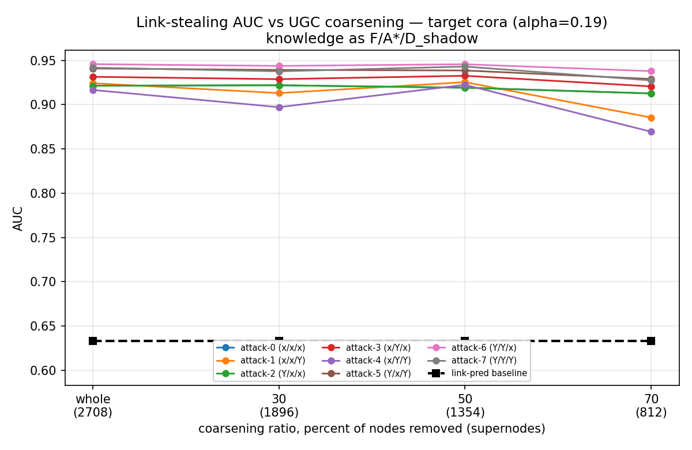
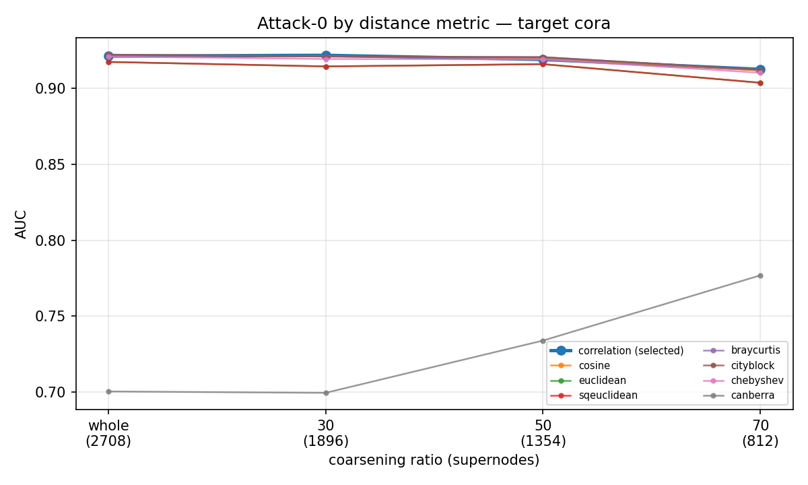
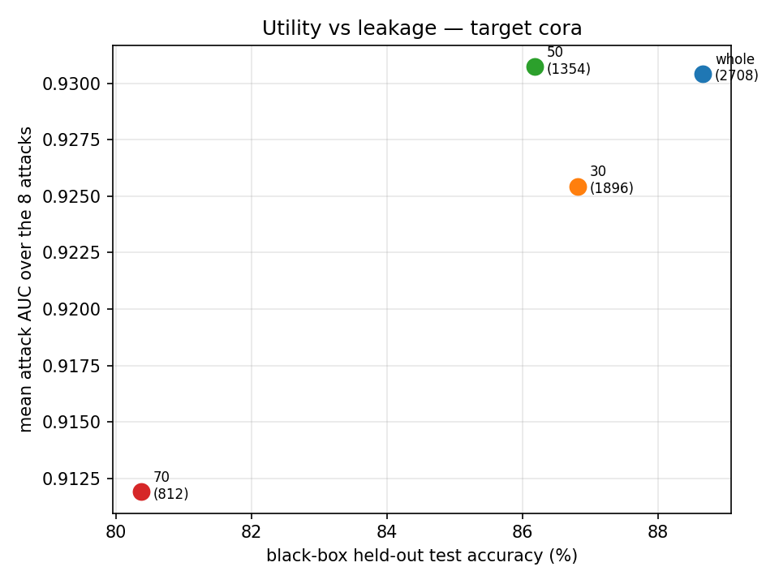
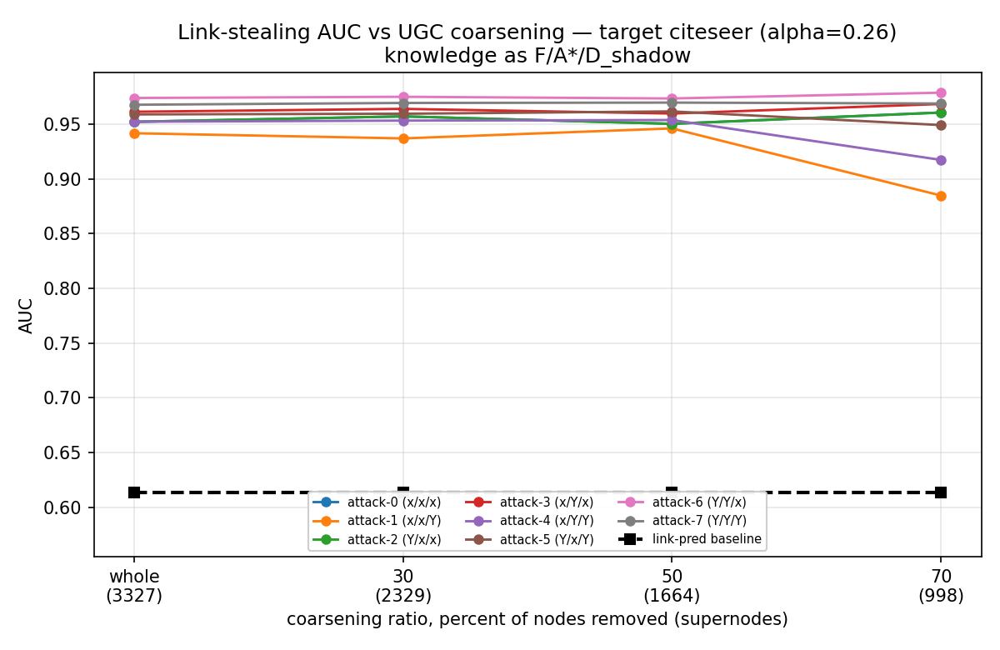
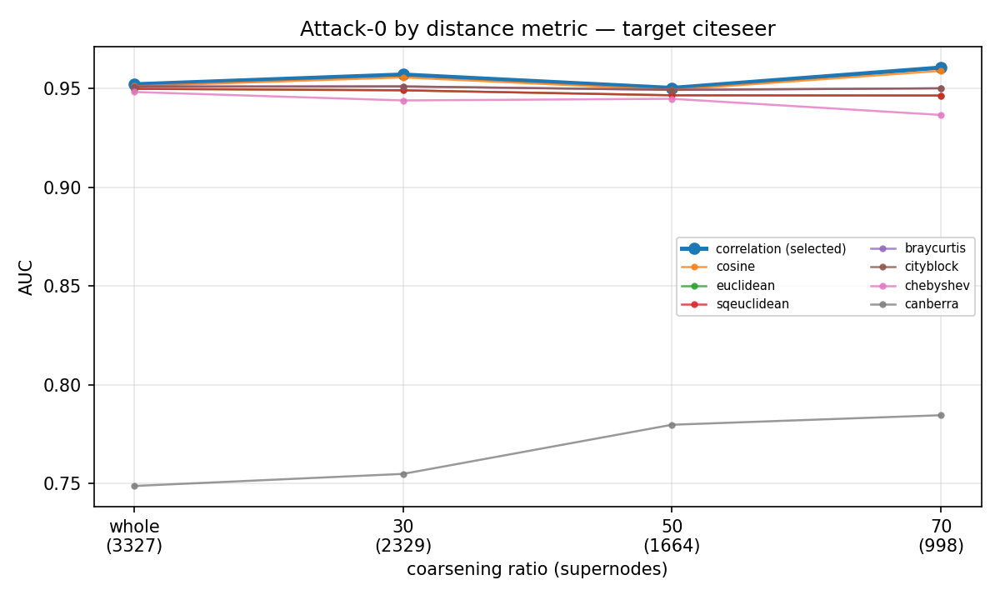
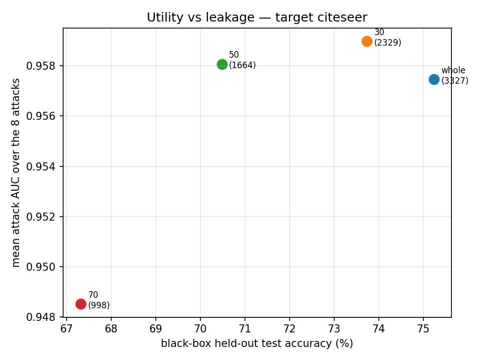

# UGC leakage benchmark — results

Do the 8 link-stealing attacks of He et al. (USENIX Security 2021) get weaker when the target GNN is trained on a graph coarsened by UGC (Universal Graph Coarsening, NeurIPS 2024)?

UGC differs from the other coarsening methods we benchmarked in one structural way: it replaces the feature matrix with `[(1-alpha)X | alpha*A]`, so every node's input vector contains its own adjacency row. That augmented matrix is what the model trains on and what it is served at inference, and inference runs over the original graph. The graph therefore reaches the model twice -- as input features and through message passing.

## Target cora, shadow citeseer (alpha = 0.19)

| attack | F/A*/D' | whole | 30 | 50 | 70 | delta |
|---|---|---|---|---|---|---|
| attack-0 | x/x/x | 0.9214 | 0.9219 | 0.9191 | 0.9127 | -0.0087 |
| attack-1 | x/x/Y | 0.9242 | 0.9131 | 0.9254 | 0.8855 | -0.0387 |
| attack-2 | Y/x/x | 0.9214 | 0.9219 | 0.9191 | 0.9127 | -0.0087 |
| attack-3 | x/Y/x | 0.9315 | 0.9288 | 0.9326 | 0.9207 | -0.0108 |
| attack-4 | x/Y/Y | 0.9166 | 0.8972 | 0.9224 | 0.8695 | -0.0471 |
| attack-5 | Y/x/Y | 0.9409 | 0.9392 | 0.9386 | 0.9290 | -0.0119 |
| attack-6 | Y/Y/x | 0.9457 | 0.9438 | 0.9456 | 0.9379 | -0.0079 |
| attack-7 | Y/Y/Y | 0.9417 | 0.9377 | 0.9430 | 0.9274 | -0.0143 |
| link-pred | – | 0.6329 | 0.6329 | 0.6329 | 0.6329 | +0.0000 |
| **mean of 8** | | **0.9304** | **0.9254** | **0.9307** | **0.9119** | **-0.0185** |

Black-box utility, held-out test accuracy on a 60/20/20 split:

| ratio | supernodes | bin width | test accuracy | paper | delta |
|---|---|---|---|---|---|
| whole | 2708 | – | 88.67 ± 0.34 | – | – |
| 30 | 1896 | 0.001854 | 86.81 ± 0.44 | 86.3 | +0.51 |
| 50 | 1354 | 0.004171 | 86.19 ± 0.30 | 86.3 | -0.11 |
| 70 | 812 | 0.009775 | 80.37 ± 0.62 | 84.63 | -4.26 |

## Target citeseer, shadow cora (alpha = 0.26)

| attack | F/A*/D' | whole | 30 | 50 | 70 | delta |
|---|---|---|---|---|---|---|
| attack-0 | x/x/x | 0.9521 | 0.9570 | 0.9503 | 0.9606 | +0.0085 |
| attack-1 | x/x/Y | 0.9416 | 0.9369 | 0.9460 | 0.8847 | -0.0569 |
| attack-2 | Y/x/x | 0.9521 | 0.9570 | 0.9503 | 0.9606 | +0.0085 |
| attack-3 | x/Y/x | 0.9613 | 0.9639 | 0.9597 | 0.9684 | +0.0071 |
| attack-4 | x/Y/Y | 0.9522 | 0.9532 | 0.9537 | 0.9173 | -0.0349 |
| attack-5 | Y/x/Y | 0.9589 | 0.9595 | 0.9616 | 0.9491 | -0.0097 |
| attack-6 | Y/Y/x | 0.9739 | 0.9749 | 0.9734 | 0.9787 | +0.0048 |
| attack-7 | Y/Y/Y | 0.9677 | 0.9693 | 0.9696 | 0.9688 | +0.0011 |
| link-pred | – | 0.6130 | 0.6130 | 0.6130 | 0.6130 | +0.0000 |
| **mean of 8** | | **0.9575** | **0.9590** | **0.9581** | **0.9485** | **-0.0089** |

Black-box utility, held-out test accuracy on a 60/20/20 split:

| ratio | supernodes | bin width | test accuracy | paper | delta |
|---|---|---|---|---|---|
| whole | 3327 | – | 75.24 ± 0.57 | – | – |
| 30 | 2329 | 0.001931 | 73.73 ± 0.31 | – | – |
| 50 | 1664 | 0.004344 | 70.48 ± 0.70 | – | – |
| 70 | 998 | 0.009514 | 67.32 ± 1.19 | – | – |

## Compared with the GCond and FGC benchmarks

All three benchmarks attack identical node pairs with identical 50/50 splits under the same pair seed, using the same attack code, so the mean AUCs are directly comparable. The reduction axes differ: GCond synthesises 35-140 nodes, FGC merges into 135-998 supernodes, UGC hashes into 812-2329.

| benchmark | target | no reduction | strongest reduction | change |
|---|---|---|---|---|
| FGC | citeseer | 0.9405 (whole) | 0.9455 (0.05) | +0.0051 |
| GCond | citeseer | 0.9704 (whole) | 0.9601 (1.0) | -0.0103 |
| UGC | citeseer | 0.9575 (whole) | 0.9485 (70) | -0.0089 |
| FGC | cora | 0.9252 (whole) | 0.9154 (0.05) | -0.0098 |
| GCond | cora | 0.9390 (whole) | 0.9502 (1.0) | +0.0112 |
| UGC | cora | 0.9304 (whole) | 0.9119 (70) | -0.0185 |

## Attack setup

| element | value |
|---|---|
| attack model | MLP, 3 hidden layers x 32, ReLU, dropout, softmax |
| optimiser | Adam, lr 0.001, cross-entropy, batch 128, 50 epochs |
| repetitions | 5 (attacks 0 and 2 are unsupervised, 1 run) |
| adversary's attributes | **original, unaugmented** (1433 Cora / 3703 Citeseer) |
| adversary's labels | random 10%, seed 123 |
| reference model g | graph-free mirror of the target: hidden 64, 500 epochs, lr 0.003, wd 0.0005 |
| shadow target | the other dataset at the same coarsening ratio |
| ground truth | original edges: 5278 Cora, 4552 Citeseer |
| pair sampling | all edges + equal non-edges, random 50/50 split |

## Black box

| element | value | source |
|---|---|---|
| model | GCN, 3 GCNConv layers: (d+n) -> 64 -> 64 -> classes | GCN.py |
| optimiser | Adam, lr 0.003, decay 0.0005, 500 epochs, NLLLoss | Table 8 |
| features | `[(1-alpha)X | alpha*A]`, dim d+n | UGC.py |
| alpha | Cora 0.19, Citeseer 0.26, fixed across ratios | Table 6, run.sh |
| split | random 60/20/20, best-validation weights | paper |
| coarsening | LSH: project, floor into bins, merge on modal bin | UGC.py |
| ratio | percent of nodes REMOVED | BinWidthFinder.py |

## Figures

## Reproduction notes

Cora at ratios 30 and 50 reproduce the paper's Table 9 to within half a point. Ratio 70 falls short by 4.26, and it is the one setting for which the authors shipped no bin width, so ours is entirely self-calibrated. Citeseer has no published UGC accuracy anywhere in the paper, so all four of its boxes are our own measurements with no target. Five of the six bin widths were calibrated here; for the one the authors did ship (Cora, ratio 50) our 0.004171 against their 0.004 gives a closer match to a true 50% reduction. Per-box numbers are in `step02_validation.json` and the calibration in `step01_calibration.json`.
