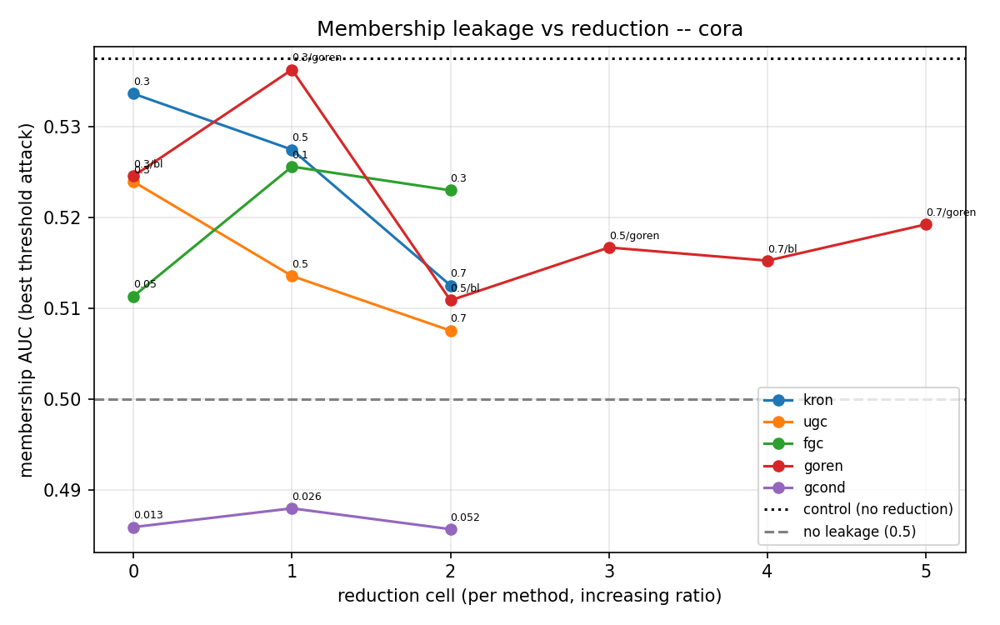
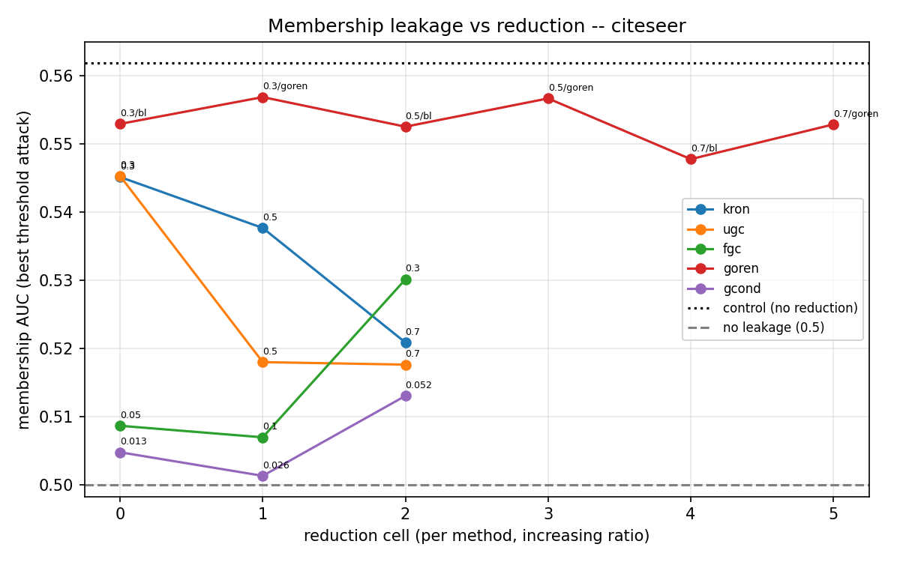
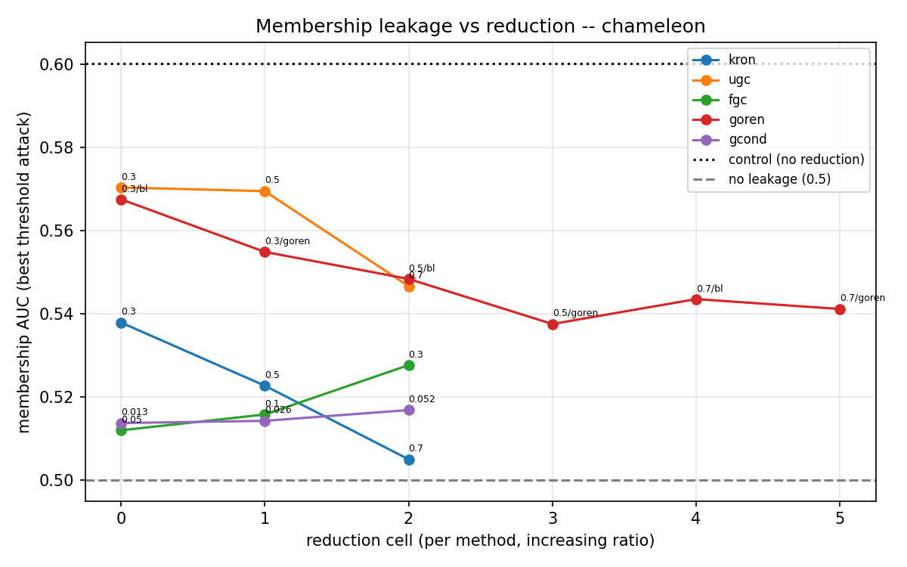
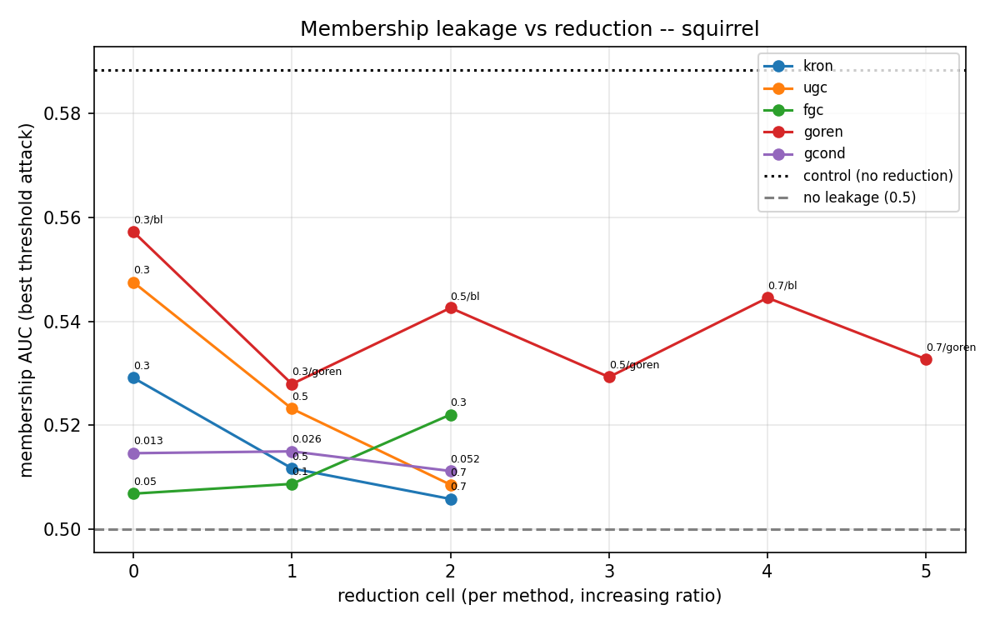

# Node membership-inference benchmark -- results

Does reducing the training graph lower a GNN's node membership leakage? Each dataset is split into members (V_in, 80%) and non-members (V_out, 20%, nodes and edges removed). Every method reduces V_in only; a uniform 3-layer GCN trains on the reduction and is served on the original graph. The 8-attack link-stealing battery does not apply here -- membership is a per-node question -- so the attacks are: unsupervised thresholds (confidence, entropy, loss, correctness) and a shadow MLP trained on the other dataset at the same cell. AUC 0.5 = no leakage.

## cora

| method | ratio | k | acc gap | best threshold AUC | shadow AUC |
|---|---|---|---|---|---|
| control | whole | 2166 | +7.50 | 0.5375 | 0.5377 |
| kron | 0.3 | 1516 | +6.73 | 0.5336 | 0.5234 |
| kron | 0.5 | 1083 | +5.50 | 0.5275 | 0.5191 |
| kron | 0.7 | 650 | +2.00 | 0.5125 | 0.4953 |
| ugc | 0.3 | 1527 | +4.79 | 0.5239 | 0.5185 |
| ugc | 0.5 | 1084 | +2.71 | 0.5136 | 0.4864 |
| ugc | 0.7 | 653 | +1.51 | 0.5075 | 0.4861 |
| fgc | 0.05 | 106 | +2.26 | 0.5113 | 0.4918 |
| fgc | 0.1 | 206 | +5.12 | 0.5256 | 0.4845 |
| fgc | 0.3 | 502 | +4.60 | 0.5230 | 0.4935 |
| goren | 0.3/bl | 1517 | +4.91 | 0.5246 | 0.5287 |
| goren | 0.3/goren | 1517 | +4.73 | 0.5363 | 0.5370 |
| goren | 0.5/bl | 1083 | +2.17 | 0.5109 | 0.5027 |
| goren | 0.5/goren | 1083 | +2.65 | 0.5167 | 0.5142 |
| goren | 0.7/bl | 651 | +1.46 | 0.5152 | 0.5106 |
| goren | 0.7/goren | 651 | +0.62 | 0.5192 | 0.5139 |
| gcond | 0.013 | 28 | -2.82 | 0.4859 | 0.4956 |
| gcond | 0.026 | 56 | -2.41 | 0.4880 | 0.5042 |
| gcond | 0.052 | 112 | -2.87 | 0.4857 | 0.4945 |

## citeseer

| method | ratio | k | acc gap | best threshold AUC | shadow AUC |
|---|---|---|---|---|---|
| control | whole | 2662 | +12.39 | 0.5619 | 0.6037 |
| kron | 0.3 | 1863 | +9.04 | 0.5452 | 0.5434 |
| kron | 0.5 | 1331 | +6.37 | 0.5377 | 0.5321 |
| kron | 0.7 | 799 | +2.69 | 0.5209 | 0.4961 |
| ugc | 0.3 | 1860 | +7.17 | 0.5453 | 0.5415 |
| ugc | 0.5 | 1335 | +1.74 | 0.5180 | 0.5071 |
| ugc | 0.7 | 795 | +1.21 | 0.5177 | 0.5134 |
| fgc | 0.05 | 130 | -0.36 | 0.5087 | 0.5006 |
| fgc | 0.1 | 260 | +1.19 | 0.5070 | 0.5029 |
| fgc | 0.3 | 390 | +3.64 | 0.5302 | 0.5023 |
| goren | 0.3/bl | 1864 | +8.67 | 0.5530 | 0.5533 |
| goren | 0.3/goren | 1864 | +8.30 | 0.5569 | 0.5419 |
| goren | 0.5/bl | 1331 | +8.02 | 0.5526 | 0.5092 |
| goren | 0.5/goren | 1331 | +8.41 | 0.5567 | 0.5319 |
| goren | 0.7/bl | 799 | +4.01 | 0.5478 | 0.5156 |
| goren | 0.7/goren | 799 | +3.52 | 0.5529 | 0.5327 |
| gcond | 0.013 | 34 | -1.04 | 0.5048 | 0.5096 |
| gcond | 0.026 | 69 | +0.27 | 0.5014 | 0.5115 |
| gcond | 0.052 | 138 | +1.05 | 0.5131 | 0.5033 |

## chameleon

| method | ratio | k | acc gap | best threshold AUC | shadow AUC |
|---|---|---|---|---|---|
| control | whole | 1822 | +13.77 | 0.6003 | 0.5924 |
| kron | 0.3 | 1275 | +5.21 | 0.5379 | 0.5309 |
| kron | 0.5 | 911 | +4.54 | 0.5227 | 0.5231 |
| kron | 0.7 | 547 | +0.42 | 0.5050 | 0.5156 |
| ugc | 0.3 | 1281 | +12.37 | 0.5704 | 0.5706 |
| ugc | 0.5 | 909 | +10.56 | 0.5695 | 0.5347 |
| ugc | 0.7 | 546 | +6.03 | 0.5466 | 0.5001 |
| fgc | 0.05 | 48 | +2.39 | 0.5120 | 0.5025 |
| fgc | 0.1 | 84 | +3.16 | 0.5158 | 0.5028 |
| fgc | 0.3 | 200 | +3.17 | 0.5277 | 0.5064 |
| goren | 0.3/bl | 1276 | +10.69 | 0.5675 | 0.5555 |
| goren | 0.3/goren | 1276 | +4.94 | 0.5549 | 0.5295 |
| goren | 0.5/bl | 911 | +8.77 | 0.5484 | 0.5425 |
| goren | 0.5/goren | 911 | +3.61 | 0.5375 | 0.5165 |
| goren | 0.7/bl | 547 | +6.16 | 0.5435 | 0.5362 |
| goren | 0.7/goren | 547 | +5.02 | 0.5412 | 0.5282 |
| gcond | 0.013 | 23 | +2.67 | 0.5137 | 0.5033 |
| gcond | 0.026 | 47 | +2.85 | 0.5142 | 0.5073 |
| gcond | 0.052 | 94 | +2.74 | 0.5168 | 0.4977 |

## squirrel

| method | ratio | k | acc gap | best threshold AUC | shadow AUC |
|---|---|---|---|---|---|
| control | whole | 4161 | +11.39 | 0.5885 | 0.5853 |
| kron | 0.3 | 2913 | +3.19 | 0.5291 | 0.5107 |
| kron | 0.5 | 2080 | +2.32 | 0.5117 | 0.5158 |
| kron | 0.7 | 1248 | +1.16 | 0.5058 | 0.5045 |
| ugc | 0.3 | 2912 | +6.22 | 0.5475 | 0.5404 |
| ugc | 0.5 | 2076 | +2.29 | 0.5232 | 0.5130 |
| ugc | 0.7 | 1242 | +0.76 | 0.5086 | 0.4862 |
| fgc | 0.05 | 19 | -0.88 | 0.5068 | 0.5027 |
| fgc | 0.1 | 182 | +0.16 | 0.5087 | 0.5054 |
| fgc | 0.3 | 325 | +0.47 | 0.5221 | 0.5054 |
| goren | 0.3/bl | 2913 | +7.71 | 0.5572 | 0.5388 |
| goren | 0.3/goren | 2913 | +3.63 | 0.5279 | 0.5215 |
| goren | 0.5/bl | 2081 | +5.55 | 0.5426 | 0.5348 |
| goren | 0.5/goren | 2081 | +3.32 | 0.5293 | 0.5145 |
| goren | 0.7/bl | 1249 | +5.18 | 0.5445 | 0.5200 |
| goren | 0.7/goren | 1249 | +3.36 | 0.5327 | 0.5100 |
| gcond | 0.013 | 54 | +2.70 | 0.5146 | 0.5018 |
| gcond | 0.026 | 108 | +2.49 | 0.5150 | 0.5034 |
| gcond | 0.052 | 216 | -0.64 | 0.5112 | 0.4979 |

## Reading it

- **control** is the reference leakage of a plain GNN on V_in.
- A method/ratio with AUC near 0.5 hides membership; above the control means it leaks more, below means less.
- GCond trains on synthetic nodes (no real node in training), so it is expected to leak least; KRON keeps real nodes, so it should track the control most closely.

## Figures

